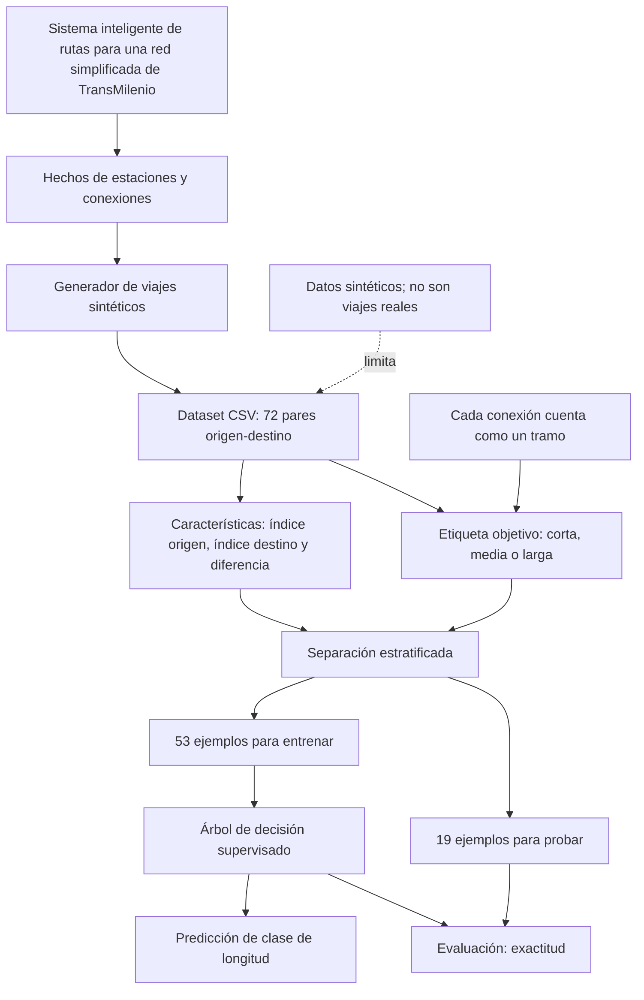

# Mapa conceptual: aprendizaje supervisado para clasificar rutas

El mapa muestra cómo los hechos de la red se convierten en ejemplos etiquetados; el árbol aprende de una parte de los ejemplos y se evalúa con otra parte que no se usó para entrenarlo.
